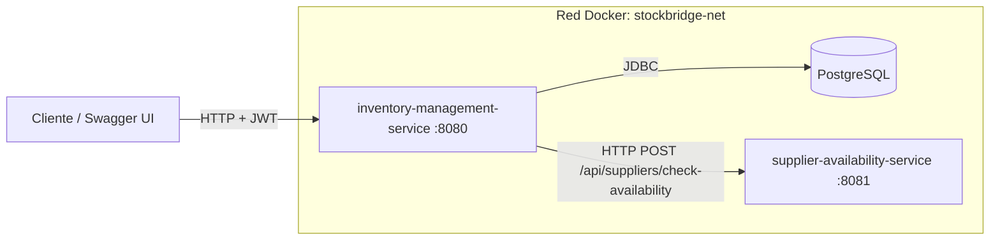
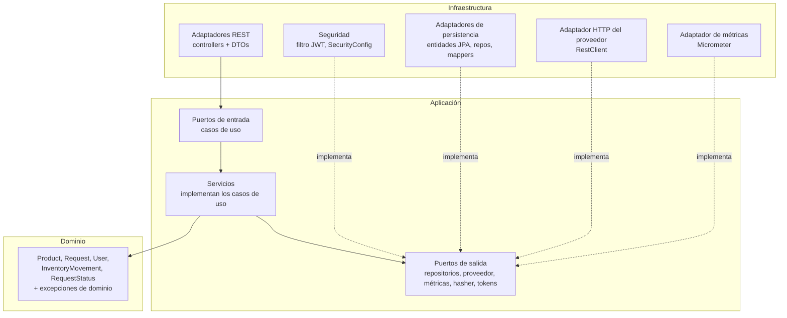
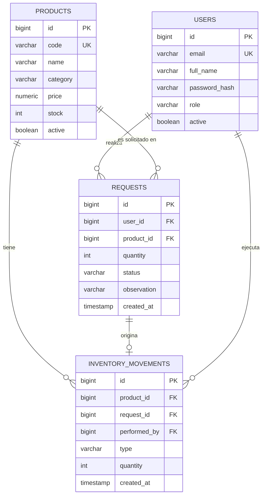
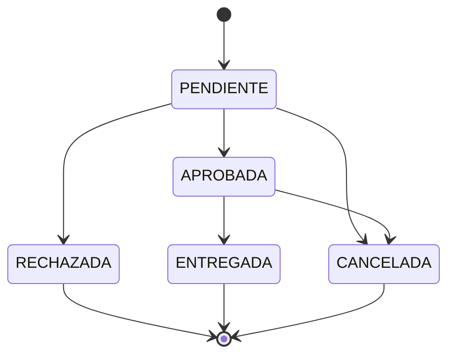

# StockBridge – Gestión de Inventario y Solicitudes Internas

Backend de dos microservicios para administrar productos, existencias, solicitudes internas y movimientos de inventario, con consulta a un servicio externo que simula la disponibilidad de abastecimiento.

- **inventory-management-service** (puerto 8080): servicio principal. Arquitectura hexagonal, JPA/Hibernate, Flyway, Spring Security + JWT, Actuator/Micrometer y OpenAPI.
- **supplier-availability-service** (puerto 8081): simulador de disponibilidad de proveedores. Respuesta determinista, sin base de datos.

---

## Tabla de contenido

1. [Stack tecnológico](#1-stack-tecnológico)
2. [Arquitectura](#2-arquitectura)
3. [Estructura del repositorio](#3-estructura-del-repositorio)
4. [Cómo ejecutar](#4-cómo-ejecutar)
5. [Credenciales y roles](#5-credenciales-y-roles)
6. [Endpoints](#6-endpoints)
7. [Modelo de datos](#7-modelo-de-datos)
8. [Reglas de negocio y estados](#8-reglas-de-negocio-y-estados)
9. [Integración con el proveedor](#9-integración-con-el-proveedor)
10. [Seguridad](#10-seguridad)
11. [Manejo de errores](#11-manejo-de-errores)
12. [Observabilidad](#12-observabilidad)
13. [Pruebas](#13-pruebas)
14. [Decisiones técnicas](#14-decisiones-técnicas)
15. [Limitaciones y mejoras futuras](#15-limitaciones-y-mejoras-futuras)
16. [Preguntas orientadoras](#16-preguntas-orientadoras)

---

## 1. Stack tecnológico

| Área | Tecnología |
|---|---|
| Lenguaje | Java 21 |
| Framework | Spring Boot 4.1.2 (Spring Framework 7, Hibernate 7) |
| Persistencia | Spring Data JPA, PostgreSQL 16, Flyway |
| Mapeo | MapStruct (dominio ↔ entidad JPA) |
| Seguridad | Spring Security, JWT (JJWT 0.12.x, HS384), BCrypt |
| Cliente HTTP | `RestClient` con timeouts de conexión y lectura |
| Observabilidad | Spring Boot Actuator, Micrometer |
| Documentación | springdoc-openapi (Swagger UI) |
| Pruebas | JUnit 5, Mockito, MockMvc, Testcontainers |
| Contenedores | Docker (multi-stage), Docker Compose |

---

## 2. Arquitectura

### 2.1 Vista general de servicios



### 2.2 Arquitectura hexagonal del servicio principal

Las dependencias apuntan siempre hacia adentro: `domain` no conoce a nadie, `application` solo conoce el dominio y sus propios puertos, e `infrastructure` conoce todo.



| Capa | Contenido | Depende de |
|---|---|---|
| `domain` | Modelos con reglas, enums, excepciones de dominio. Java puro, sin Spring ni JPA | nada |
| `application` | Casos de uso (puertos de entrada), puertos de salida, servicios con `@Transactional` | `domain` |
| `infrastructure` | Controllers REST, entidades JPA, adaptadores, seguridad, configuración | `application`, `domain` |

---

## 3. Estructura del repositorio

```
Stockbridge/
├── docker-compose.yaml
├── README.md
├── .gitignore
├── inventory-management-service/
│   ├── Dockerfile
│   ├── pom.xml
│   └── src/
│       ├── main/java/com/stockbridge/inventory
│       │   ├── domain/            (model, exception)
│       │   ├── application/       (common, port/in, port/out, service)
│       │   └── infrastructure/
│       │       ├── adapter/in/rest        (controllers, DTOs, exception/GlobalExceptionHandler)
│       │       ├── adapter/out/persistence (entidades, repos Spring Data, mappers, adaptadores)
│       │       ├── adapter/out/supplier    (cliente HTTP)
│       │       ├── adapter/out/metrics     (Micrometer)
│       │       └── config/                 (seguridad, propiedades, OpenAPI, métricas)
│       ├── main/resources/db/migration     (V1..V4 Flyway)
│       └── test/
└── supplier-availability-service/
    ├── Dockerfile
    ├── pom.xml
    └── src/main/java/com/stockbridge/supplier
        ├── controller/
        ├── dto/
        └── service/
```

El servicio de proveedores usa capas simples (controller, service, dto) porque no tiene base de datos, ni reglas de negocio, ni infraestructura que proteger. La hexagonal se aplicó donde existe dominio: el servicio principal.

---

## 4. Cómo ejecutar

### 4.1 Requisitos

- Docker y Docker Compose
- Para ejecución local sin contenedores: Java 21 y Maven 3.9+

### 4.2 Todo el sistema con un solo comando

Desde la raíz del repositorio:

```bash
docker compose up --build
```

Levanta PostgreSQL, el servicio de proveedores y el servicio de inventario. Flyway crea las tablas y se crea el administrador inicial automáticamente.

| Recurso | URL |
|---|---|
| API de inventario | http://localhost:8080 |
| Swagger UI (público) | http://localhost:8080/swagger-ui.html |
| Salud | http://localhost:8080/actuator/health |
| Servicio de proveedores | http://localhost:8081 |
| PostgreSQL (desde el host) | `localhost:5439` (usuario/clave/BD: `inventory`) |

Para detener y borrar los datos: `docker compose down -v`.

### 4.3 Ejecución local (sin contenedor de aplicación)

```bash
# 1. Base de datos
docker compose up -d postgres

# 2. Proveedor
cd supplier-availability-service && mvn spring-boot:run

# 3. Inventario (otra terminal)
cd inventory-management-service && mvn spring-boot:run
```

### 4.4 Variables de entorno

| Variable | Descripción | Valor por defecto |
|---|---|---|
| `SPRING_DATASOURCE_URL` | URL JDBC | `jdbc:postgresql://localhost:5439/inventory` |
| `SPRING_DATASOURCE_USERNAME` / `_PASSWORD` | Credenciales de BD | `inventory` / `inventory` |
| `SUPPLIER_URL` | URL base del proveedor | `http://localhost:8081` |
| `JWT_SECRET` | Secreto HMAC del JWT (mínimo 32 caracteres) | valor de desarrollo |
| `ADMIN_EMAIL` / `ADMIN_PASSWORD` | Administrador inicial | `admin@gmail.com` / `admin123` |

> Los valores por defecto son solo para desarrollo. En un entorno real el secreto y las claves se inyectan como variables de entorno o secretos del orquestador, nunca desde el repositorio.

---

## 5. Credenciales y roles

Administrador inicial (creado por `AdminBootstrap` si no existe): **`admin@gmail.com` / `admin123`**.

| Rol | Permisos |
|---|---|
| `EMPLEADO` | Registrar solicitudes, consultar y cancelar **solo las propias**, consultar productos |
| `BODEGA` | Todo lo anterior sobre cualquier solicitud, además de aprobar, rechazar, entregar y consultar movimientos |
| `ADMIN` | Administrar productos y usuarios, más todo lo de BODEGA |

El registro público (`/auth/register`) **siempre** crea un `EMPLEADO`: nadie puede autoasignarse un rol superior. Un ADMIN asciende usuarios con `PATCH /api/users/{id}/role`.

---

## 6. Endpoints

Documentación interactiva completa en **Swagger UI**. Para probar desde allí: ejecuta `POST /auth/login`, copia el token y pulsa **Authorize**.

### Autenticación (públicos)

| Método | Ruta | Descripción |
|---|---|---|
| POST | `/auth/register` | Registra un usuario con rol EMPLEADO |
| POST | `/auth/login` | Devuelve un JWT |

### Productos

| Método | Ruta | Rol | Descripción |
|---|---|---|---|
| POST | `/api/products` | ADMIN | Crear |
| GET | `/api/products` | autenticado | Listar (paginado) |
| GET | `/api/products/{id}` | autenticado | Consultar |
| GET | `/api/products/low-stock?minimum=N` | autenticado | Productos con stock menor a N |
| PUT | `/api/products/{id}` | ADMIN | Actualizar nombre, descripción, categoría y precio |
| PATCH | `/api/products/{id}/activate` | ADMIN | Activar |
| PATCH | `/api/products/{id}/deactivate` | ADMIN | Desactivar |

### Solicitudes

| Método | Ruta | Rol | Descripción |
|---|---|---|---|
| POST | `/api/requests` | autenticado | Crear solicitud |
| GET | `/api/requests/mine` | autenticado | Mis solicitudes |
| GET | `/api/requests` | BODEGA, ADMIN | Todas (filtro opcional `status`) |
| GET | `/api/requests/{id}` | autenticado | Consultar (EMPLEADO solo las propias) |
| PATCH | `/api/requests/{id}/approve` | BODEGA, ADMIN | Aprobar |
| PATCH | `/api/requests/{id}/reject` | BODEGA, ADMIN | Rechazar (motivo obligatorio) |
| PATCH | `/api/requests/{id}/cancel` | autenticado | Cancelar (EMPLEADO solo las propias) |
| PATCH | `/api/requests/{id}/deliver` | BODEGA, ADMIN | Entregar: descuenta stock y registra movimiento |

### Movimientos y usuarios

| Método | Ruta | Rol | Descripción |
|---|---|---|---|
| GET | `/api/movements?productId=N` | BODEGA, ADMIN | Historial de un producto |
| PATCH | `/api/users/{id}/role` | ADMIN | Cambiar rol |

### Observabilidad

| Método | Ruta | Acceso |
|---|---|---|
| GET | `/actuator/health`, `/actuator/info` | público |
| GET | `/actuator/metrics`, `/actuator/metrics/{nombre}` | autenticado |

### Proveedor (servicio independiente, puerto 8081)

```http
POST /api/suppliers/check-availability
Content-Type: application/json

{ "productCode": "MON-001", "quantity": 10, "category": "MONITORES" }
```

```json
{ "supplierCode": "SUP-001", "available": false, "availableQuantity": 5, "estimatedDeliveryDays": 6 }
```

---

## 7. Modelo de datos



Las migraciones están en `src/main/resources/db/migration` (V1 a V4). Hibernate corre con `ddl-auto=validate`: **el esquema lo controla Flyway**, Hibernate solo verifica. Las tablas tienen `CHECK` (`price > 0`, `stock >= 0`, `quantity > 0`, estados y roles válidos) como segunda línea de defensa tras el dominio, e índices en las llaves foráneas.

---

## 8. Reglas de negocio y estados

### Productos

- Código único; precio mayor que cero; stock no negativo.
- Un producto inactivo no puede solicitarse.
- `decreaseStock` vive dentro de `Product`: la regla "no descontar más de lo que hay" no depende de que cada caso de uso la recuerde.

### Transiciones de estado de una solicitud



`RECHAZADA`, `ENTREGADA` y `CANCELADA` son estados finales. Las transiciones se definen en un solo lugar (`RequestStatus.canTransitionTo`) y cualquier intento inválido lanza `InvalidStateTransitionException` (409).

### Creación de una solicitud

1. Se valida la cantidad (dominio) y que el producto exista y esté activo.
2. Si hay stock local suficiente, se crea `PENDIENTE`.
3. Si no, se consulta al proveedor:
   - Con disponibilidad externa: se crea `PENDIENTE` con una observación que indica proveedor, unidades y días de entrega.
   - Sin disponibilidad: 409.
   - Proveedor caído o lento: 503 y **no** se crea la solicitud.

### Entrega transaccional

`RequestService.deliver` corre en **una sola transacción**:

1. Carga la solicitud y el producto con `SELECT ... FOR UPDATE`.
2. `request.deliver()` (falla si no está APROBADA).
3. `product.decreaseStock(qty)` (falla si no hay stock).
4. Guarda producto y solicitud.
5. Registra el `InventoryMovement` de salida.

Si cualquier paso falla (incluido el INSERT del movimiento), se revierte todo: el stock, el estado y el movimiento. Esto está demostrado con un test de integración.

---

## 9. Integración con el proveedor

El inventario depende del puerto `SupplierAvailabilityPort`; solo `SupplierHttpAdapter` conoce HTTP.

| Aspecto | Decisión |
|---|---|
| Timeout de conexión | 2 s |
| Timeout de lectura | 3 s |
| Fallo (timeout, conexión rechazada, 4xx, 5xx) | `SupplierUnavailableException` → 503 con `ProblemDetail` |
| Efecto sobre la solicitud | No se crea: nunca se promete abastecimiento sin confirmarlo |
| Métricas | Latencia con etiqueta `outcome=ok/error` y contador de errores |

**Determinismo del proveedor:** la respuesta se calcula con `String.hashCode()` sobre `código|categoría` (definido por la especificación de Java, estable entre ejecuciones). La misma combinación de datos produce siempre la misma respuesta.

---

## 10. Seguridad

- **Stateless:** sin sesiones; toda la identidad viaja en el JWT.
- **JWT:** firmado con HMAC (HS384 por el tamaño del secreto). Claims: `sub` (id), `email`, `role`, `iat`, `exp`. Vigencia: 60 minutos.
- **Validación:** un filtro (`JwtAuthenticationFilter`) verifica firma y vencimiento en cada petición. Un token alterado o vencido recibe 401. El payload está codificado en Base64, **no cifrado**: no contiene datos sensibles.
- **Contraseñas:** BCrypt mediante `PasswordEncoder`. El dominio solo guarda el hash y nunca conoce el encoder (puerto `PasswordHasherPort`).
- **Control de acceso por rol:** reglas por ruta en `SecurityConfig`.
- **Control de propiedad:** el id del usuario sale **del token**, nunca de un parámetro del cliente. Un empleado que consulta o cancela la solicitud de otro recibe **404** (no 403), para no confirmar que ese id existe.
- **Login:** el mensaje es el mismo para usuario inexistente y contraseña incorrecta.
- **401 vs 403:** 401 = no sé quién eres (sin token, inválido, vencido); 403 = sé quién eres, pero no tienes permiso.

---

## 11. Manejo de errores

Todas las respuestas de error usan `ProblemDetail` (RFC 9457, `application/problem+json`), centralizadas en `GlobalExceptionHandler`.

| Tipo de error | HTTP | Ejemplo |
|---|---|---|
| Validación de entrada (Bean Validation) | 400, con mapa `errors` por campo | precio negativo, código vacío |
| Parámetro con formato inválido | 400 | `/api/users/abc/role` |
| No autenticado | 401 | token ausente, inválido, vencido; credenciales incorrectas |
| No autorizado | 403 | EMPLEADO intentando crear un producto |
| Recurso no encontrado | 404 | producto, solicitud o usuario inexistente; solicitud ajena |
| Conflicto de estado | 409 | código o email duplicado, stock insuficiente, transición inválida |
| Regla de negocio | 422 | producto inactivo, cantidad inválida |
| Proveedor externo | 503 | caído, error o timeout |
| Falla interna | 500 | error inesperado (se registra con `log.error`) |

Los errores de seguridad (401/403) que ocurren en el filtro, antes de llegar a un controller, se escriben en el mismo formato desde `RestSecurityErrorHandler`.

---

## 12. Observabilidad

Actuator expone `health`, `info` y `metrics`. Las métricas propias (Micrometer):

| Métrica | Tipo | Significado |
|---|---|---|
| `stockbridge.requests.created` | contador | solicitudes creadas |
| `stockbridge.requests.approved` | contador | solicitudes aprobadas |
| `stockbridge.requests.rejected` | contador | solicitudes rechazadas |
| `stockbridge.requests.cancelled` | contador | solicitudes canceladas |
| `stockbridge.requests.delivered` | contador | entregas realizadas |
| `stockbridge.products.low_stock` | gauge | productos con stock menor a 5 |
| `stockbridge.supplier.latency` | timer (`outcome`) | duración de las consultas al proveedor |
| `stockbridge.supplier.errors` | contador | consultas fallidas al proveedor |

Los contadores aparecen al ocurrir el primer evento. Consulta:

```bash
curl -s localhost:8080/actuator/metrics/stockbridge.requests.created \
  -H "Authorization: Bearer $TOKEN"
```

**¿Falla la base de datos o el proveedor?**

- Suben `stockbridge.supplier.errors` y la latencia con `outcome=error`, y el log muestra `Falla consultando proveedor`: es el servicio externo.
- Esas métricas quietas, `/actuator/health` con el componente `db` en `DOWN`, `hikaricp.connections.*` saturadas y `Error inesperado` con una excepción JDBC/Hibernate en el log: es la base de datos.

---

## 13. Pruebas

```bash
cd inventory-management-service
mvn test
```

| Nivel | Clase | Qué verifica |
|---|---|---|
| Unitaria (dominio) | `ProductTest`, `RequestTest` | reglas de `Product`, transiciones de estado, estados finales |
| Unitaria (casos de uso, Mockito) | `RequestServiceTest` | entrega con y sin stock, estado inválido, creación con proveedor simulado (con stock, sin stock, caído), propiedad |
| Integración (MockMvc + Testcontainers) | `InventoryFlowIntegrationTest` | seguridad (401/403, token manipulado), validaciones, flujo completo, propiedad (404), proveedor simulado, **rollback de la entrega** |

Las pruebas de integración usan **PostgreSQL real** en un contenedor (`postgres:16-alpine`, la misma imagen que el compose) y requieren Docker activo. Cada prueba crea sus propios datos con identificadores únicos.

**Por qué Mockito no reemplaza una prueba con base real:** con puertos simulados no existe transacción, bloqueo de filas, restricciones `CHECK` ni migraciones. El test de rollback comprueba contra PostgreSQL que, si falla el registro del movimiento, el stock vuelve a su valor original, la solicitud sigue `APROBADA` y no queda ningún movimiento huérfano.

---

## 14. Decisiones técnicas

| Decisión | Justificación |
|---|---|
| Hexagonal en el servicio principal | Hay dominio rico e infraestructura intercambiable. Cambiar de base de datos solo toca `adapter/out/persistence` y la configuración |
| Dominio separado de las entidades JPA | JPA exige constructor vacío y setters; el dominio exige estados siempre válidos. Se acepta el costo del mapeo |
| Constructor privado + fábricas `create`/`restore` | Nombran la intención y hacen imposible un objeto inválido. `restore` también valida: falla pronto si la BD está corrupta |
| `final` solo en identidad y hechos históricos | `id`, `code`, `userId`, etc. no cambian; lo que tiene comportamiento de negocio es mutable pero solo por métodos que validan |
| El dominio guarda `userId`/`productId`, no objetos | Evita acoplar agregados; `@ManyToOne` vive solo en la entidad JPA |
| Excepciones de dominio con base común | Un solo handler atrapa las reglas de negocio y se distinguen de fallas técnicas |
| `@Transactional` en la capa de aplicación | La transacción define la unidad de trabajo del caso de uso |
| Bloqueo pesimista (`PESSIMISTIC_WRITE`) en la entrega | Dos entregas simultáneas del mismo producto se serializan; el stock nunca queda negativo. El `CHECK (stock >= 0)` es la última red |
| `FetchType.LAZY` + `@EntityGraph` | Listar solicitudes con usuario y producto en una sola consulta (sin N+1) |
| `open-in-view=false` | Evita ocultar problemas de lazy loading y N+1 |
| Flyway + `ddl-auto=validate` | Esquema versionado y reproducible; Hibernate solo verifica |
| Paginación propia (`PageResult`) | No filtra tipos de Spring Data hacia la capa de aplicación |
| 404 en recursos ajenos | No revela la existencia de ids de otros usuarios |
| Registro público siempre EMPLEADO | Evita escalada de privilegios |
| Hasher y emisor de tokens como puertos | Aplicación y dominio no dependen de BCrypt ni JJWT |
| Timeouts y 503 ante fallo del proveedor | La espera tiene techo; el hilo no se cuelga indefinidamente |
| Docker multi-stage, usuario sin privilegios | Imagen final con solo JRE y el jar; capas de dependencias cacheadas |
| `healthcheck` + `depends_on` | El inventario espera a que PostgreSQL acepte conexiones antes de que Flyway migre |

---

## 15. Limitaciones y mejoras futuras

- **Rol en el token:** un cambio de rol o la desactivación de un usuario se refleja al volver a iniciar sesión; un token ya emitido sigue válido hasta vencer (60 min). Mejora: lista de revocación o tokens de acceso más cortos con refresh token.
- **Llamada HTTP dentro de la transacción:** al crear una solicitud sin stock local, la consulta al proveedor ocurre dentro de `@Transactional` y retiene una conexión hasta 3 s en el peor caso. Mejora: consultar fuera de la transacción.
- **Resiliencia:** hay timeouts pero no circuit breaker ni reintentos (Resilience4j sería el siguiente paso).
- **Métricas dentro de la transacción:** un contador puede subir y luego haber rollback; es aceptable como aproximación operativa.
- **Secretos:** los valores por defecto son de desarrollo.
- **Gestión de usuarios:** el enunciado no exige activar/desactivar usuarios desde la API; el campo `active` existe y el login lo respeta.

---

## 16. Preguntas orientadoras

**Si mañana se cambia PostgreSQL por otra base, ¿qué se modifica?**
Solo `infrastructure/adapter/out/persistence`, el driver, la configuración y las migraciones. `domain`, `application` y los controllers permanecen intactos porque dependen de puertos, no de implementaciones.

**¿Qué pasa si se descuentan diez unidades pero falla el registro del movimiento?**
Como todo ocurre en una sola transacción, la `RuntimeException` provoca rollback: el stock vuelve a su valor, la solicitud sigue APROBADA y no queda movimiento. Cubierto por un test de integración.

**¿Cómo se evita que un empleado lea la solicitud de otro?**
El caso de uso compara el dueño de la solicitud con el id que viene del token (no de la petición). Si no coincide responde 404.

**¿Por qué Mockito no reemplaza una prueba con base real?**
Porque no ejercita transacciones, bloqueos, restricciones, migraciones ni el mapeo real de Hibernate.

**¿Cómo se evita stock negativo con solicitudes simultáneas?**
`SELECT ... FOR UPDATE` serializa las entregas del mismo producto, el dominio valida el stock con el valor ya actualizado y la base tiene `CHECK (stock >= 0)`.

**¿Cómo se detecta y evita un problema N+1?**
Activando `show-sql` y revisando que un listado dispare una sola consulta con `join`. Se resuelve con `@EntityGraph(attributePaths = {"user", "product"})`.

**¿Qué pasa si el proveedor no responde?**
Los timeouts (2 s conexión, 3 s lectura) cortan la espera, se cuenta el error en Micrometer y el cliente recibe 503 con `ProblemDetail`. La solicitud no se crea.

**¿Qué controles impiden usar un JWT manipulado o acceder a recursos administrativos?**
La firma HMAC se verifica en cada petición (si cambia el payload, la firma no coincide: 401) y las rutas administrativas exigen `ROLE_ADMIN` (403 en caso contrario).